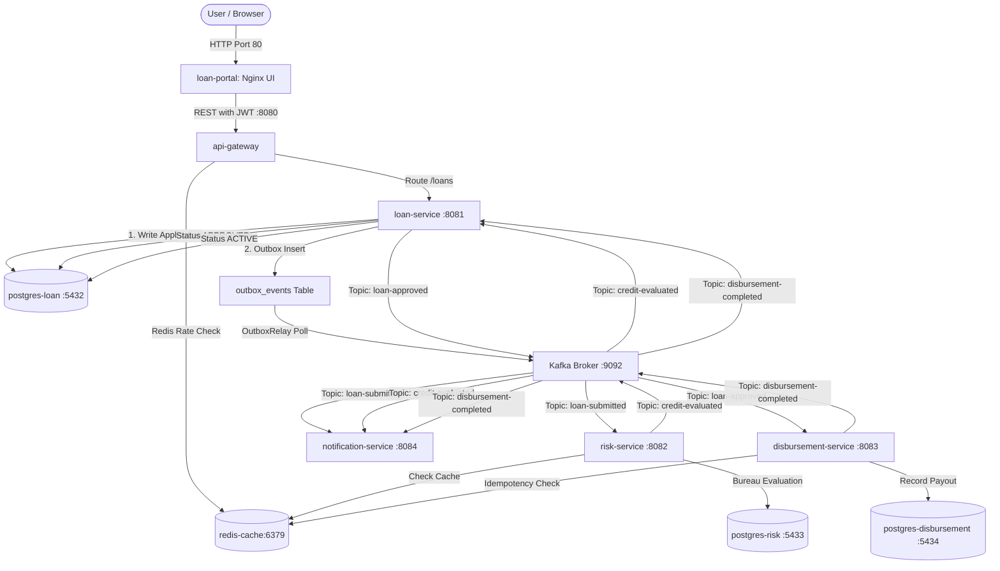

# Enterprise Loan Management Platform — Architectural & Operational Guide

---

## 1. Executive Summary & Project Flow (End-to-End)

The **Loan Management Platform** is a distributed, event-driven microservices ecosystem built with **Spring Boot 3 (Java 17/21)**, **Apache Kafka**, **PostgreSQL**, **Redis**, and orchestrated via **Docker Compose**. It handles the complete lifecycle of personal and enterprise loan processing: from initial user submission, CIBIL bureau verification, algorithmic risk assessment, loan status transitions, idempotent bank disbursement, to customer notification.



### Complete End-to-End Business Flow

1. **Authentication & Ingress**: The applicant opens the web portal (`http://localhost`). The frontend requests a cryptographic JWT token from `api-gateway` (`POST /api/v1/auth/token`).
2. **Loan Submission**: The applicant fills in their PAN (`BXCPV7093L`), phone, name, and requested loan amount. The request enters `loan-service` via the Gateway.
3. **Transactional Outbox Event**: `loan-service` writes the loan application to PostgreSQL (`loan_db`) in status `SUBMITTED`, and in the **same database transaction**, writes an event to the `outbox_events` table.
4. **Reliable Kafka Streaming**: The `OutboxRelay` background daemon polls `outbox_events`, deserializes the event, and publishes to the `loan-submitted` topic on Kafka with partition key = `loanReferenceId`.
5. **CIBIL Score Verification & Risk Assessment**:
   - `risk-service` consumes `loan-submitted`.
   - It checks Redis for a cached score (`cibil:pan:BXCPV7093L`). If missing, it computes the bureau score based on PAN hash rules and caches it for 30 days.
   - If CIBIL >= 650 -> `APPROVED`. If 600–649 -> `MANUAL_REVIEW`. If < 600 -> `REJECTED`.
   - Idempotently saves the assessment to `risk_db` and publishes to topic `credit-evaluated`.
6. **State Machine Transition to APPROVED**: `loan-service` consumes `credit-evaluated`, updates loan status to `APPROVED`, persists the CIBIL score (e.g. 780), and emits a `loan-approved` Kafka event.
7. **Idempotent Bank Payout (Disbursement)**:
   - `disbursement-service` consumes `loan-approved`.
   - It executes a Redis distributed lock & check: `setIfAbsent("idempotency:" + loanRef, "PROCESSING")`.
   - Simulates core-banking payout (`PAYOUT-XXXXXXXX`), saves the record in `disbursement_db`, marks key as `COMPLETED`, and publishes to `disbursement-completed`.
8. **Final State Transition to ACTIVE**: `loan-service` consumes `disbursement-completed` and transitions the loan status from `APPROVED` to `ACTIVE`.
9. **Multi-Stage Customer Notifications**: Throughout each step, `notification-service` consumes events and dispatches asynchronous confirmation emails/SMS.

---

## 2. Microservices Architecture & Integration Details

The ecosystem consists of **5 business domain microservices** and **14 supporting infrastructure services** (19 total containers):

| Service | Port | Database / State Store | Primary Responsibilities |
|---|---|---|---|
| **`api-gateway`** | 8080 | Redis (Port 6379) | Reverse proxy, JWT generation & verification, Redis Token Bucket rate limiter (60 req/min), path routing. |
| **`loan-service`** | 8081 | PostgreSQL `loan_db` (Port 5432) | Loan CRUD, Transactional Outbox pattern, Outbox polling relay, state machine manager. |
| **`risk-service`** | 8082 | PostgreSQL `risk_db` (Port 5433) + Redis | CIBIL credit score evaluation, bureau caching (TTL 30 days), underwriting rule engine. |
| **`disbursement-service`** | 8083 | PostgreSQL `disbursement_db` (Port 5434) + Redis | Core banking payout simulation, Redis idempotency gatekeeper, payout tracking REST API. |
| **`notification-service`** | 8084 | Stateless / Kafka consumer | Asynchronous multi-stage event consumption and notification delivery (email/SMS simulator). |
| **`service-registry`** | 8761 | Eureka In-Memory | Netflix Eureka service registration, heartbeats, client-side discovery. |
| **`config-server`** | 8888 | Local Git / Classpath Repo | Externalized configuration management for all microservices. |
| **`loan-portal`** | 80 | Nginx Static Alpine | React-like dark-mode single page application (SPA), real-time stepper, CIBIL gauge. |
| **`jenkins-ci`** | 8085 | Docker Volume `jenkins_home` | Automated CI/CD pipeline, pre-baked with Maven 3.9.6, JDK 17, Docker CLI, and JCasC. |

### Observability & Infrastructure Stack

- **Apache Kafka + Zookeeper-less KRaft Mode (`kafka-broker:9092`)**: Event backbone for all microservice communication.
- **Prometheus (`prometheus-metrics:9090`)**: Scrapes Spring Boot Actuator endpoints (`/actuator/prometheus`) across all microservices every 15s.
- **Grafana (`grafana-dashboard:3000`)**: Pre-provisioned dashboards for JVM metrics, HTTP throughput, and Loki logs.
- **Grafana Loki (`loki-logs:3100`) + Promtail (`promtail-collector`)**: Centralized Docker container log aggregation and querying.
- **Zipkin (`zipkin-tracing:9411`)**: Distributed trace visualization propagating B3/W3C trace context headers across gateway, services, and Kafka records.

---

## 3. Design Patterns Implemented

### 1. Transactional Outbox Pattern
- **Problem**: When a service modifies its local database and publishes a message to Kafka, network failure or crashes between the two operations create dual-write inconsistencies.
- **Solution**: Inside `LoanServiceImpl.applyForLoan()`, the loan entity and an `OutboxEvent` are written to the local PostgreSQL database in the **same ACID transaction**. A dedicated background thread (`OutboxRelay`) polls pending events, publishes them to Kafka with acknowledgments (`get()`), and marks them `PUBLISHED`.

### 2. Database-per-Service Pattern
- **Problem**: Shared databases lead to tight coupling, schema lock conflicts, and unscalable deployments.
- **Solution**: Each service has its own dedicated PostgreSQL instance with isolated credentials and schemas (`loan_db:5432`, `risk_db:5433`, `disbursement_db:5434`). Microservices never access foreign databases directly; communication is strictly through Kafka events or API Gateway REST calls.

### 3. API Gateway Pattern
- **Problem**: Exposing multiple microservice ports directly to client browsers leads to security vulnerabilities, CORS issues, and complex frontend clients.
- **Solution**: `api-gateway` acts as a single point of entry on port 8080. It handles JWT authentication, rate limiting, and forwards downstream traffic to `loan-service` and `disbursement-service`.

### 4. Idempotent Consumer & Distributed Lock Pattern
- **Problem**: Kafka provides *at-least-once* delivery semantics. Rebalancing or retried messages can result in duplicate disbursements.
- **Solution**: 
  - `DisbursementServiceImpl` uses Redis `setIfAbsent("idempotency:" + loanRef, "PROCESSING", 24h)`. Any duplicate event within 24 hours is rejected immediately.
  - `RiskService` checks `findByLoanReferenceId()` before attempting an insert, preventing duplicate key violations and infinite retry loops.

### 5. Cache-Aside Pattern
- **Problem**: Direct calls to external credit bureaus (like CIBIL) are expensive and introduce external latency.
- **Solution**: `CibilBureauService` checks Redis for key `cibil:pan:{PAN}`. On a cache hit, it returns the score instantly. On a cache miss, it simulates bureau resolution, writes to Redis with a 30-day TTL, and returns the result.

### 6. State Machine Guard Pattern
- **Problem**: Out-of-order Kafka message deliveries could cause a loan already marked `ACTIVE` to revert back to `APPROVED`.
- **Solution**: `LoanServiceImpl.updateLoanStatus` enforces strict forward-only lifecycle progression (`SUBMITTED` -> `APPROVED` -> `ACTIVE`). Duplicate or regression transitions are safely ignored.

### 7. Externalized Configuration & Service Discovery
- Config Server provides centralized configuration from a single repository.
- Eureka Service Registry allows dynamic discovery without hardcoding IP addresses.

---

## 4. End-to-End Testing Guide

### Automated PowerShell Script (Recommended)

Run the automated verification script from your terminal:

```powershell
cd d:\loan-management-system\loan-management-platform
powershell -ExecutionPolicy Bypass -File scripts\test_e2e.ps1
```

The script performs the following assertions:
1. Obtains a JWT Token from Gateway (`POST http://localhost:8080/api/v1/auth/token`).
2. Submits a new loan application (`POST http://localhost:8080/api/v1/loans`).
3. Polls every 2 seconds until the loan status reaches `ACTIVE`.
4. Verifies the calculated CIBIL score is populated (`creditScore: 780`).
5. Queries the disbursement record (`GET http://localhost:8080/api/v1/disbursements/loan/{loanRef}`).
6. Asserts the payout transaction ID (`PAYOUT-XXXXXXXX`) and status `SUCCESS`.

### Manual Testing via Web UI

1. Open **http://localhost** in any browser.
2. Fill out the application form:
   - **Customer ID**: `CUST-1001`
   - **Applicant Name**: `Vijay jangili`
   - **PAN Card**: `BXCPV7093L`
   - **Phone**: `9100334722`
   - **Amount**: `75000`
3. Click **Submit Loan Application**.
4. Watch the real-time pipeline stepper update live:
   - `Application Submitted` -> `CIBIL Check (Score: 780)` -> `Risk Underwriting Approved` -> `Disbursement Completed`.
5. View the event stream terminal and the generated Payout ID card on the right panel.

---

## 5. CI/CD Pipeline (Jenkins)

The repository contains a declarative `Jenkinsfile` executing a 5-stage automated delivery pipeline:

```
[Stage 1: Parallel Unit Testing] -> [Stage 2: Package JARs] -> [Stage 3: Docker Build] -> [Stage 4: Ephemeral Integration Test] -> [Stage 5: Publish Images]
```

### How to Access and Run the Pipeline

1. **Open Jenkins**: Navigate to **http://localhost:8085/jenkins**.
2. **Login Credentials**:
   - **Username**: `admin`
   - **Password**: `admin123`
3. **Pre-configured Pipeline**: The job `loan-management-platform` is already provisioned by JCasC and connected to:
   `https://github.com/janvijay90-ship-it/loan-management-platform.git`
4. **Trigger a Build**:
   - Click into **loan-management-platform**.
   - Click **Build Now** on the left menu.
5. **Stages executed**:
   - `Parallel Unit Testing`: Executes `mvn test` in parallel across all 5 microservice modules.
   - `Build Microservice Binaries`: Runs `mvn clean package -DskipTests` via root POM.
   - `Build Docker Images`: Runs `docker compose build`.
   - `Integration Smoke Testing`: Spins up an ephemeral container stack and executes `scripts/test_e2e.sh`.
   - `Deliver / Publish`: Publishes verified artifacts (runs only on `main` branch).

---

## 6. Essential Docker Commands

### Starting & Stopping

```powershell
# Start all 19 services in detached mode with build
docker compose up --build -d

# Start without rebuilding images
docker compose up -d

# Stop all containers while preserving database volumes
docker compose stop

# Stop and remove all containers, networks
docker compose down

# Stop and wipe everything (including databases and Redis state)
docker compose down -v
```

### Inspecting & Debugging

```powershell
# List all running containers and their port mappings
docker ps --format "table {{.Names}}\t{{.Status}}\t{{.Ports}}"

# Follow live logs for a specific microservice
docker logs -f loan-service
docker logs -f risk-service
docker logs -f disbursement-service
docker logs -f notification-service
docker logs -f api-gateway

# View last 100 log lines of a service
docker logs --tail 100 loan-service

# Rebuild and restart only one updated service (zero-downtime)
docker compose up -d --build loan-service
docker compose up -d --build risk-service
docker compose up -d --build disbursement-service
```

### Container Shell Access & Troubleshooting

```powershell
# Open bash inside Kafka container to inspect topics
docker compose exec kafka-broker /opt/kafka/bin/kafka-topics.sh --bootstrap-server localhost:9092 --list

# Inspect messages on the loan-submitted topic
docker compose exec kafka-broker /opt/kafka/bin/kafka-console-consumer.sh --bootstrap-server localhost:9092 --topic loan-submitted --from-beginning

# Connect to Loan PostgreSQL database
docker compose exec postgres-loan psql -U loan_user -d loan_db

# Query loan records directly from PostgreSQL
docker compose exec postgres-loan psql -U loan_user -d loan_db -c "SELECT id, loan_reference_id, applicant_name, credit_score, status FROM loan_applications;"

# Query Outbox events status
docker compose exec postgres-loan psql -U loan_user -d loan_db -c "SELECT id, event_type, status, published_at FROM outbox_events;"

# Check Redis keys
docker compose exec redis-cache redis-cli KEYS "*"
```

---

## 7. Essential Git Commands

### Everyday Development Workflow

```powershell
# Check modified files and branch status
git status

# View commit history (concise 1-line view)
git log --oneline -10

# Stage changes
git add .

# Commit with a descriptive message
git commit -m "feat(module): describe what you changed"

# Push to your GitHub repository
git push origin main
```

### Syncing & Remote Management

```powershell
# Verify configured remote repository URL
git remote -v

# Fetch and pull latest changes from GitHub
git pull origin main

# Discard local uncommitted changes to a specific file
git restore path/to/file

# Create and switch to a new feature branch
git checkout -b feature/new-underwriting-rule

# Switch back to main branch
git checkout main
```
