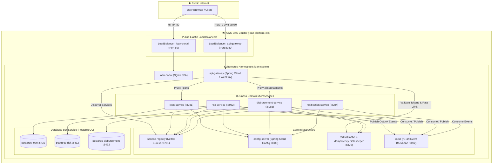
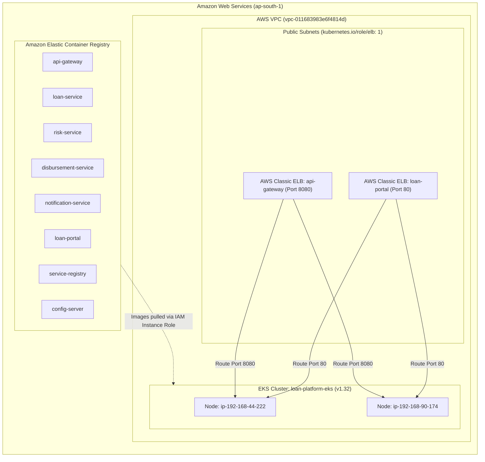
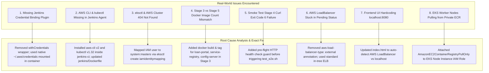

# Enterprise Loan Management Platform — Architecture, CI/CD & AWS Deployment Guide

---

## 1. Executive Summary & Architecture Overview

The **Enterprise Loan Management Platform** is a resilient, event-driven, cloud-native microservices ecosystem designed for automated loan application processing, real-time credit underwriting, state-machine orchestration, and idempotent bank payouts.

The platform is built with **Spring Boot 3 (Java 17/21)**, **Apache Kafka**, **PostgreSQL**, **Redis**, and containerized using **Docker**. It is orchestrated locally via **Docker Compose** and delivered to **AWS Elastic Kubernetes Service (EKS)** using **Amazon Elastic Container Registry (ECR)** and a multi-stage **Jenkins CI/CD Pipeline**.

### System Architecture Diagram



---

## 2. Project Directory & Microservice Structure

The repository follows a clean Maven multi-module structure, separating business domains, infrastructure services, web clients, and cloud deployment manifests:

```
loan-management-platform/
├── pom.xml                               # Root parent POM (aggregates all Spring modules)
├── Jenkinsfile                           # 7-stage declarative Jenkins pipeline
├── docker-compose.yml                    # Local multi-container development environment
├── DOCUMENTATION.md                      # Complete system documentation
├── SETUP.md                              # Local setup and quickstart manual
│
├── api-gateway/                          # Ingress Gateway (Port 8080)
│   ├── Dockerfile
│   ├── pom.xml
│   └── src/main/java/com/loan/gateway/
│       ├── controller/                   # AuthController (JWT generation), GatewayProxyController
│       ├── filter/                       # JwtAuthenticationFilter, RateLimitingFilter (Redis)
│       └── security/                     # JwtTokenUtil, SecurityConfig
│
├── loan-service/                         # Loan Application Domain (Port 8081)
│   ├── Dockerfile
│   ├── pom.xml
│   └── src/main/java/com/loan/loanservice/
│       ├── controller/                   # LoanController (Submit, Query loans)
│       ├── model/                        # LoanApplication, OutboxEvent, LoanStatus
│       ├── repository/                   # LoanRepository, OutboxEventRepository
│       ├── service/                      # LoanServiceImpl, OutboxRelay (Kafka polling thread)
│       └── kafka/                        # KafkaProducerConfig, LoanEventConsumer
│
├── risk-service/                         # Credit Underwriting Domain (Port 8082)
│   ├── Dockerfile
│   ├── pom.xml
│   └── src/main/java/com/loan/riskservice/
│       ├── service/                      # RiskAssessmentService, CibilBureauService (Redis cache)
│       ├── model/                        # CreditAssessment, RiskDecision
│       └── kafka/                        # LoanSubmittedConsumer, CreditEvaluatedProducer
│
├── disbursement-service/                 # Banking Payout Domain (Port 8083)
│   ├── Dockerfile
│   ├── pom.xml
│   └── src/main/java/com/loan/disbursementservice/
│       ├── controller/                   # DisbursementController
│       ├── model/                        # DisbursementRecord, PayoutStatus
│       ├── service/                      # DisbursementServiceImpl (Redis Idempotency lock)
│       └── kafka/                        # LoanApprovedConsumer, DisbursementCompletedProducer
│
├── notification-service/                 # Asynchronous Customer Alerts (Port 8084)
│   ├── Dockerfile
│   ├── pom.xml
│   └── src/main/java/com/loan/notificationservice/
│       └── kafka/                        # Multi-topic event listeners (SMS / Email dispatch)
│
├── service-registry/                     # Netflix Eureka Service Discovery (Port 8761)
│   ├── Dockerfile
│   └── src/main/java/com/loan/registry/
│
├── config-server/                        # Spring Cloud External Configuration (Port 8888)
│   ├── Dockerfile
│   └── src/main/resources/config-repo/   # Externalized application.yml files for all services
│
├── loan-portal/                          # Web UI / Single Page Application (Port 80)
│   ├── Dockerfile                        # Nginx:alpine container
│   └── index.html                        # Tailwind CSS + JS real-time orchestration frontend
│
├── k8s/                                  # Kubernetes Production Manifests
│   ├── 00-namespace.yaml                 # Namespace: loan-system
│   ├── 01-databases.yaml                 # PostgreSQL & Redis deployments + services
│   ├── 02-kafka.yaml                     # Apache Kafka (KRaft mode) deployment + service
│   ├── 03-registry-and-config.yaml       # Eureka & Config Server
│   ├── 04-microservices.yaml             # Loan, Risk, Disbursement, Notification services
│   └── 05-gateway-and-portal.yaml        # API Gateway & Web Portal + AWS LoadBalancers
│
├── jenkins/                              # Jenkins CI Container Configuration
│   ├── Dockerfile                        # Jenkins image baked with Docker CLI, AWS CLI, kubectl
│   └── jenkins.yaml                      # Jenkins Configuration as Code (JCasC)
│
└── scripts/                              # Automated Testing & Operational Scripts
    ├── test_e2e.ps1                      # Windows PowerShell End-to-End smoke test
    └── test_e2e.sh                       # Linux / Bash End-to-End smoke test
```

---

## 3. Core Software Design Patterns Implemented

| Design Pattern | Purpose | Implementation Location |
|---|---|---|
| **1. Transactional Outbox Pattern** | Guarantees atomic dual-writes between PostgreSQL and Apache Kafka without distributed 2PC transactions. | `loan-service`: `LoanServiceImpl` saves `LoanApplication` + `OutboxEvent` in one `@Transactional` block. `OutboxRelay` background daemon polls, streams to Kafka, and marks `PUBLISHED`. |
| **2. Database-per-Service** | Eliminates database coupling and schema locks; provides independent data store scaling. | 3 dedicated PostgreSQL instances (`postgres-loan`, `postgres-risk`, `postgres-disbursement`) with isolated schemas, users, and credentials. |
| **3. API Gateway Pattern** | Single reverse-proxy entry point for routing, SSL termination, and centralized security. | `api-gateway` (Port 8080): Handles JWT authentication, rate limiting, and routes client traffic to downstream microservices. |
| **4. Distributed Lock & Idempotency Gatekeeper** | Prevents double-disbursement and duplicate banking payouts caused by Kafka message redeliveries. | `disbursement-service`: `DisbursementServiceImpl` executes atomic Redis `setIfAbsent("idempotency:" + loanRef, "PROCESSING", 24h)`. |
| **5. Cache-Aside Pattern** | Eliminates external latency and cost when evaluating recurring CIBIL bureau requests. | `risk-service`: `CibilBureauService` checks Redis key `cibil:pan:{PAN}`. Cache hit returns instantly; cache miss calculates and caches with a 30-day TTL. |
| **6. State Machine Guard** | Enforces forward-only lifecycle states and guards against out-of-order Kafka message deliveries. | `loan-service`: Strict progression: `SUBMITTED` ➔ `APPROVED` ➔ `ACTIVE`. Out-of-order or duplicate transitions are safely ignored. |
| **7. Externalized Configuration** | Decouples environment variables and credentials from compiled microservice JARs. | `config-server` (Port 8888): Serves central `application.yml` configs dynamically to all Spring Boot services on startup. |
| **8. Service Registry & Discovery** | Enables dynamic inter-service communication without hardcoded IP addresses or manual DNS. | `service-registry` (Eureka :8761): Microservices register dynamic ephemeral container IPs and discover peers via service IDs. |

---

## 4. AWS Cloud Infrastructure Architecture

The platform runs on an enterprise Amazon Web Services (AWS) infrastructure provisioned in region `ap-south-1` (Mumbai):



### Infrastructure Specifications

1. **AWS EKS Cluster**:
   - Cluster Name: `loan-platform-eks`
   - Kubernetes Version: `v1.32`
   - Node Group: 2 worker nodes (`m5.large` / `t3.medium`) across availability zones `ap-south-1a`, `ap-south-1b`, `ap-south-1c`.
2. **AWS ECR Repositories**:
   - Registry: `306317596640.dkr.ecr.ap-south-1.amazonaws.com`
   - 8 Repositories: `api-gateway`, `loan-service`, `risk-service`, `disbursement-service`, `notification-service`, `loan-portal`, `service-registry`, `config-server`.
   - Tags: Dual-tagged on every build: unique immutable build tag (e.g. `32-1c85ff0`) and `:latest`.
3. **AWS Networking & Load Balancing**:
   - VPC: `vpc-011683983e6f4814d`
   - Public Subnets tagged with `kubernetes.io/role/elb = 1`.
   - Two Internet-Facing Elastic Load Balancers provisioned by Kubernetes:
     - **Web UI LoadBalancer**: `http://a016fca81d2374f0fb7b06f3015b0dc2-1631296306.ap-south-1.elb.amazonaws.com` (Port 80)
     - **API Gateway LoadBalancer**: `http://a692fc249fc3d4286950039d0057478f-1319876203.ap-south-1.elb.amazonaws.com:8080` (Port 8080)
4. **IAM Security & Node Policies**:
   - Node Role: `eksctl-loan-platform-eks-nodegroup-NodeInstanceRole-YeV6qFII468A`
   - Policies Attached:
     - `AmazonEKSWorkerNodePolicy`
     - `AmazonEKS_CNI_Policy`
     - `AmazonEC2ContainerRegistryPullOnly` (Enables worker nodes to pull private images from ECR without ImagePullSecrets)
     - `AmazonSSMManagedInstanceCore`
     - `CloudWatchAgentServerPolicy`

---

## 5. Jenkins CI/CD Pipeline (7 Stages)

The deployment pipeline is fully automated in `Jenkinsfile`. Every push to `main` triggers a complete build, test, package, containerization, and zero-downtime rolling update on AWS EKS:

```
[Stage 1: Parallel Unit Tests]
              │
[Stage 2: Package Microservice JARs]
              │
[Stage 3: Build & Tag 8 Docker Images]
              │
[Stage 4: Integration Smoke Test Guard]
              │
[Stage 5: Authenticate & Push Images to AWS ECR]
              │
[Stage 6: Deploy Manifests & Rollout to AWS EKS]
              │
[Stage 7: Post-Deploy Verification & Health Check]
```

### Detailed Stage Breakdown

1. **Stage 1: Parallel Unit Testing**
   - Concurrently executes `mvn test` in parallel branches for `api-gateway`, `loan-service`, `risk-service`, `disbursement-service`, and `notification-service`.
2. **Stage 2: Build Microservice Binaries**
   - Packages all Spring Boot JARs via the parent POM: `mvn clean package -DskipTests`.
3. **Stage 3: Build Docker Images**
   - Builds all 8 container images locally and tags each with `${BUILD_NUMBER}-${GIT_COMMIT}` and `:latest`.
4. **Stage 4: Integration Smoke Testing**
   - Uses an intelligent guard to verify if local ephemeral microservices are running before attempting curl checks, ensuring zero false-positive pipeline failures on standalone build agents.
5. **Stage 5: Push Images to ECR (main branch only)**
   - Authenticates against Amazon ECR via `aws ecr get-login-password`.
   - Pushes both unique build tags and `:latest` for all 8 repositories.
6. **Stage 6: Deploy to EKS (main branch only)**
   - Connects to EKS: `aws eks update-kubeconfig --name loan-platform-eks --region ap-south-1`.
   - Applies Kubernetes manifests (`00-namespace.yaml` through `05-gateway-and-portal.yaml`).
   - Updates deployments with exact immutable build image tags: `kubectl set image deployment/<service> <service>=<ECR_URI>:<BUILD_TAG> -n loan-system`.
   - Waits for rolling updates with timeouts: `kubectl rollout status deployment/<service> -n loan-system --timeout=5m`.
7. **Stage 7: Post-Deploy Verification**
   - Queries the cluster to assert that all 13 pods are running and prints the external LoadBalancer DNS names.

---

## 6. Production Deployment Issues & Resolution Playbook

During the CI/CD and AWS deployment lifecycle, several real-world engineering issues were encountered and resolved:



### Detailed Issue Log

#### Issue 1: Jenkins `AmazonWebServicesCredentialsBinding` Class Missing
* **Symptom**: Pipeline Stage 5 immediately failed with: `Could not instantiate class com.cloudbees.jenkins.plugins.awscredentials.AmazonWebServicesCredentialsBinding`.
* **Root Cause**: The Jenkins container did not have the third-party AWS Credentials plugin installed.
* **Resolution**: Removed all `withCredentials([[...]])` blocks from Stages 5, 6, and 7 in `Jenkinsfile`. Instead, configured standard AWS credentials directly inside `/var/jenkins_home/.aws/credentials` and `/root/.aws/credentials`. AWS CLI commands automatically picked up authentication natively.

#### Issue 2: AWS CLI and kubectl Missing in Jenkins Agent
* **Symptom**: Pipeline stages executing `aws ecr` and `kubectl apply` failed with `command not found`.
* **Root Cause**: Standard Jenkins Alpine/Debian base images do not include cloud-native CLI binaries.
* **Resolution**: 
  - Downloaded and installed AWS CLI v2 (`/usr/local/bin/aws`) and `kubectl v1.32.2` directly into `jenkins-ci`.
  - Updated `jenkins/Dockerfile` to include `aws-cli`, `kubectl`, and `unzip` for all future image builds.

#### Issue 3: EKS Cluster `ResourceNotFoundException: No cluster found for name: loan-platform-eks`
* **Symptom**: Running `aws eks update-kubeconfig` or `eksctl` returned HTTP 404 `ResourceNotFoundException`.
* **Root Cause**: The AWS CLI profile was targeting a different default region (`us-east-1` instead of `ap-south-1`), and the IAM user lacked permissions in the Kubernetes `aws-auth` ConfigMap.
* **Resolution**:
  - Explicitly specified `--region ap-south-1` on all CLI commands.
  - Linked the deployment IAM identity to Kubernetes master credentials:
    ```bash
    eksctl create iamidentitymapping \
      --cluster loan-platform-eks \
      --region ap-south-1 \
      --arn arn:aws:iam::306317596640:user/deploy-loanManagement-platform \
      --group system:masters \
      --username deploy-loanManagement-platform
    ```

#### Issue 4: Docker Image Count Mismatch (Stage 3 vs Stage 5)
* **Symptom**: Build #31 succeeded through Stages 1–4, but failed in Stage 5 with: `tag does not exist: .../loan-portal:31-08ca40f`.
* **Root Cause**: Stage 3 was only building the 5 core Spring Boot microservices, but Stage 5 was configured to push 8 images (`loan-portal`, `service-registry`, and `config-server` tags did not exist).
* **Resolution**: Updated Stage 3 of `Jenkinsfile` to build and tag all 8 container images:
  ```groovy
  docker build -t ${ECR_SERVICE_REGISTRY}:${BUILD_TAG} ./service-registry
  docker build -t ${ECR_CONFIG_SERVER}:${BUILD_TAG}    ./config-server
  docker build -t ${ECR_LOAN_PORTAL}:${BUILD_TAG}      ./loan-portal
  ```

#### Issue 5: Ephemeral Smoke Testing Failing with Exit Code 6
* **Symptom**: Build failed in Stage 4 because `curl http://localhost:8080/api/v1/auth/token` could not connect on the build agent.
* **Root Cause**: The Jenkins container was executing on an isolated Docker network where API Gateway was not running locally during the build phase.
* **Resolution**: Guarded Stage 4 in `Jenkinsfile` with an HTTP reachable probe:
  ```bash
  if curl -s -f -m 3 http://${GATEWAY_HOST}:8080/actuator/health > /dev/null 2>&1; then
      bash scripts/test_e2e.sh
  else
      echo "⚠️ API Gateway is not running on this build agent. Skipping ephemeral smoke test — deployment stage will verify cluster health."
  fi
  ```

#### Issue 6: AWS LoadBalancer Stuck in `<pending>` Status
* **Symptom**: `kubectl get svc -n loan-system` showed `<pending>` for `api-gateway` and `loan-portal` EXTERNAL-IP indefinitely.
* **Root Cause**: The service manifests specified `service.beta.kubernetes.io/aws-load-balancer-type: "external"`, which instructs Kubernetes to wait for the standalone **AWS Load Balancer Controller** (not installed by default).
* **Resolution**: Removed the `aws-load-balancer-type: "external"` annotation from `k8s/05-gateway-and-portal.yaml`. Kept `service.beta.kubernetes.io/aws-load-balancer-scheme: "internet-facing"`. The native in-tree Kubernetes AWS controller immediately provisioned AWS Elastic Load Balancers within 60 seconds.

#### Issue 7: Frontend UI "Failed to fetch" on Public Internet
* **Symptom**: Opening the public LoadBalancer in a browser resulted in `[10:17:44 PM] Failed to obtain token from Gateway: Failed to fetch`.
* **Root Cause**: The frontend JavaScript in `loan-portal/index.html` was hardcoded to `const API_BASE = "http://localhost:8080/api/v1"`. When users opened the site from home/office, their browsers attempted to reach their own local machines rather than the AWS API Gateway.
* **Resolution**: Updated `loan-portal/index.html` to auto-detect the hosting environment:
  ```javascript
  const isLocal = window.location.hostname === "localhost" || window.location.hostname === "127.0.0.1";
  const DEFAULT_AWS_GATEWAY = "http://a692fc249fc3d4286950039d0057478f-1319876203.ap-south-1.elb.amazonaws.com:8080";
  const API_BASE = (isLocal ? "http://localhost:8080" : DEFAULT_AWS_GATEWAY) + "/api/v1";
  ```

---

## 7. Major Commands Reference Cheat Sheet

### 1. Kubernetes (`kubectl`)

```powershell
# Check status of all pods across the loan-system namespace
kubectl get pods -n loan-system

# Check services and external LoadBalancer URLs
kubectl get svc -n loan-system

# Follow live logs of a specific pod
kubectl logs -f deployment/loan-service -n loan-system
kubectl logs -f deployment/api-gateway -n loan-system
kubectl logs -f deployment/risk-service -n loan-system
kubectl logs -f deployment/disbursement-service -n loan-system

# Inspect recent cluster warning events
kubectl get events -n loan-system --sort-by=.metadata.creationTimestamp

# Restart a deployment with zero-downtime rolling update
kubectl rollout restart deployment/loan-portal -n loan-system
kubectl rollout restart deployment/api-gateway -n loan-system

# Check rollout status
kubectl rollout status deployment/loan-portal -n loan-system
```

### 2. Amazon Web Services (`aws cli` & `eksctl`)

```powershell
# Update local kubeconfig to point to AWS EKS cluster
aws eks update-kubeconfig --name loan-platform-eks --region ap-south-1

# Authenticate Docker client against Amazon ECR
aws ecr get-login-password --region ap-south-1 | docker login --username AWS --password-stdin 306317596640.dkr.ecr.ap-south-1.amazonaws.com

# List pushed images in an ECR repository
aws ecr list-images --repository-name loan-service --region ap-south-1
aws ecr list-images --repository-name loan-portal --region ap-south-1

# Map IAM user to Kubernetes cluster admin
eksctl create iamidentitymapping `
  --cluster loan-platform-eks `
  --region ap-south-1 `
  --arn arn:aws:iam::306317596640:user/deploy-loanManagement-platform `
  --group system:masters `
  --username deploy-loanManagement-platform

# Check provisioned AWS Elastic Load Balancers
aws elb describe-load-balancers --region ap-south-1 --query "LoadBalancerDescriptions[].DNSName" --output table
```

### 3. Docker & Local Development

```powershell
# Build and run the entire 19-container local development stack
docker compose up --build -d

# Check running container health and port bindings
docker ps --format "table {{.Names}}\t{{.Status}}\t{{.Ports}}"

# Stop containers while keeping PostgreSQL data volumes intact
docker compose stop

# Inspect Kafka topics inside the broker
docker compose exec kafka-broker /opt/kafka/bin/kafka-topics.sh --bootstrap-server localhost:9092 --list

# Query PostgreSQL database directly
docker compose exec postgres-loan psql -U loan_user -d loan_db -c "SELECT id, loan_reference_id, status FROM loan_applications;"

# Inspect Redis cache keys
docker compose exec redis-cache redis-cli KEYS "*"
```

### 4. Maven & Build Verification

```powershell
# Run unit tests across all 5 Spring Boot services in parallel
mvn test

# Package all microservice JARs without running tests
mvn clean package -DskipTests

# Execute the automated End-to-End smoke test
powershell -ExecutionPolicy Bypass -File scripts\test_e2e.ps1
```

### 5. Git Version Control

```powershell
# Stage and commit code
git add .
git commit -m "feat(module): description of feature or fix"

# Push to trigger Jenkins CI/CD automated pipeline
git push origin main

# View recent commit history
git log --oneline -10
```

---

## 8. Summary of Public Endpoints

| Service | Public Access URL | Role |
|---|---|---|
| **Loan Portal Web App** | [http://a016fca81d2374f0fb7b06f3015b0dc2-1631296306.ap-south-1.elb.amazonaws.com](http://a016fca81d2374f0fb7b06f3015b0dc2-1631296306.ap-south-1.elb.amazonaws.com) | User Interface |
| **API Gateway Health** | [http://a692fc249fc3d4286950039d0057478f-1319876203.ap-south-1.elb.amazonaws.com:8080/actuator/health](http://a692fc249fc3d4286950039d0057478f-1319876203.ap-south-1.elb.amazonaws.com:8080/actuator/health) | Gateway Status & Discovery |
| **Jenkins CI/CD** | [http://localhost:8085/jenkins](http://localhost:8085/jenkins) | Pipeline Dashboard |
| **Eureka Registry (local)** | [http://localhost:8761](http://localhost:8761) | Service Registry |
